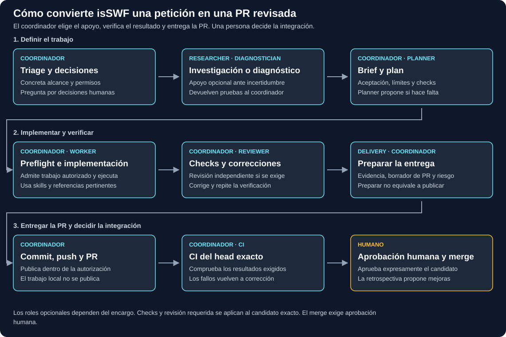

# isSWF

[English](README.md) | Español

isSWF te ayuda a dirigir el trabajo de desarrollo asistido por IA mediante encargos pequeños y revisables. Tú mantienes el control: instalar la integración no inicia agentes, y un flujo de funcionalidad no autoriza su merge ni su despliegue.

## Empieza con un host nativo

El flujo compartido actual admite Windows y Linux nativos con **Pi** o **Claude Code**. Pi delega mediante la extensión `pi-subagents`, que se instala por separado; Claude Code utiliza sus agentes nativos. Estos encargos mediante hosts nativos no necesitan el ejecutor compilado heredado ni una versión de runtime fijada para el proyecto. Consulta [compatibilidad de los hosts](docs/host-portability.md) para conocer su configuración, límites de capacidad y evidencias de verificación.

1. Prepara los recursos de isSWF de confianza y la delegación nativa siguiendo la [guía de Pi](.agents/hosts/pi.md) o la [guía de Claude Code](.agents/hosts/claude-code.md); consulta [compatibilidad de los hosts](docs/host-portability.md) para cargar la integración. Si utilizas este checkout de desarrollo, sigue también la [separación del checkout de código fuente](docs/es/development.md#separar-este-checkout-del-código-fuente-de-una-release-instalada). La instalación compilada descrita más abajo es una vía heredada independiente.
2. En el repositorio de destino, ejecuta `/skill:isswf-setup` en Pi o `/isswf:isswf-setup` en Claude Code.
3. Para iniciar un encargo, dirígelo explícitamente al coordinador de isSWF. Las peticiones normales no activan un flujo automático.

La configuración prepara las decisiones específicas del proyecto y la entrada acotada del coordinador en el `AGENTS.md` raíz. Esa entrada se activa con una petición explícita al coordinador/a isSWF, no con cualquier petición de programación. La instalación o la configuración por sí solas no autorizan acciones futuras ni demuestran que un modelo esté disponible. Consulta la [guía de primeros pasos](docs/es/getting-started.md).

## Registro y entrega del trabajo

Antes de delegar trabajo nativo, el coordinador registra un plan duradero de iniciativa y un brief de encargo con la información pertinente en el directorio de estado existente (`.isswf` o el histórico `.factory`). Las tareas pequeñas no necesitan invocar un planificador ni generar un paquete fijo de documentos. Workers y revisores devuelven evidencias asociadas al candidato concreto; las comprobaciones y revisiones se eligen de forma proporcional, no son roles obligatorios para cada tarea. Herramientas de contexto opcionales como Engram o Codegraph no sustituyen los registros del proyecto.

Una petición seleccionada de funcionalidad a PR sigue la política de entrega preparada para el proyecto, con comprobaciones y revisión acotadas cuando correspondan. Entregar una PR es una decisión distinta de integrarla en la rama base. La petición puede establecer límites más estrechos y locales; elegir seguimiento mediante GitHub no concede permiso para publicar. Consulta [trabajo duradero](docs/durable-work.md), [cómo funciona la factoría](docs/es/reference.md) y [comprobaciones de desarrollo](docs/es/development.md).

## Diagramas del flujo

El [resumen](docs/es/workflow.svg) ofrece una vista rápida. Abre el flujo completo como página web: [Español](https://iseoane.github.io/isSWF/docs/es/workflow.html) · [English](https://iseoane.github.io/isSWF/docs/en/workflow.html). Los diagramas conservan detalles de ejecución heredados y sirven de orientación, no como contrato del comportamiento nativo actual; consulta las guías enlazadas para conocerlo. Para verlo sin conexión, descarga el [HTML fuente en español](docs/es/workflow.html) o el [HTML fuente en inglés](docs/en/workflow.html); GitHub muestra estos archivos fuente como código.

El sitio está publicado en [https://iseoane.github.io/isSWF/](https://iseoane.github.io/isSWF/). Las actualizaciones siguen siendo manuales: abre **Actions → Publish workflow diagrams → Run workflow**, selecciona `main` y ejecútalo cuando la publicación esté autorizada. No hay despliegue automático al hacer push. La fase de preparación solo incluye la página de inicio bilingüe y los dos diagramas completos.

## Release compilada conservada (vía heredada)

La instalación antigua del ejecutor compilado es una vía independiente, no un requisito para las nuevas tareas con hosts nativos. La evidencia de releases documentada se limita a Linux x64; tiene restricciones distintas de runtime, aislamiento y migración, y no certifica la ejecución nativa en Windows/macOS. Adoptar el flujo nativo no migra instalaciones existentes. Antes de elegir esa vía, consulta la [instalación y los límites del runtime heredado](docs/es/installation.md) y las evidencias de la release concreta. La versión del manifiesto no demuestra que exista una release publicada; no deduzcas una última release ni publicación en un registro a partir de ella.

## Más información

- [Índice de documentación](docs/es/index.md)
- [Instalación y actualizaciones](docs/es/installation.md)
- [Primeros pasos](docs/es/getting-started.md)
- [Compatibilidad de los hosts](docs/host-portability.md)
- [Glosario](GLOSSARY.es.md)
- [Colaborar](docs/es/development.md)

## Licencia

MIT.
