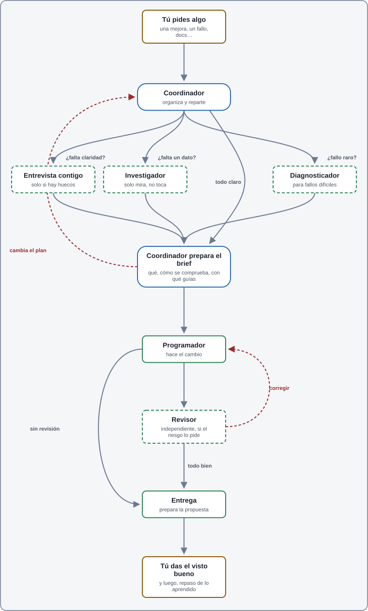

# isSWF

[English](README.md) | Español

isSWF es una factoría de software asistida por IA: los agentes de IA hacen el trabajo y tú tomas las decisiones. Divide una petición en trabajos pequeños y fáciles de comprobar, elige las comprobaciones según el riesgo y conserva evidencias de lo que se hizo, de modo que nada se fusiona ni se publica si tú no lo decides.



La imagen es un resumen: las cajas son pasos y las flechas muestran adónde va el trabajo después. Para ver la versión en la que cada paso enumera las preguntas que se hace, abre el [diagrama interactivo](https://iseoane.github.io/isSWF/docs/es/workflow.html) ([English](https://iseoane.github.io/isSWF/docs/en/workflow.html)). [Cómo se decide el trabajo](docs/es/reference.md#cómo-se-decide-el-trabajo-y-quién-decide) lo explica con palabras.

## Una primera sesión completa

1. **Instálalo.** isSWF funciona con **Pi** y con **Claude Code**, los asistentes de programación en los que se ejecutan los agentes, en Windows y Linux. Sigue la [guía de instalación](docs/es/installation.md) de tu entorno; la [compatibilidad de los hosts](docs/host-portability.md) indica qué puede hacer cada uno. Instalar no inicia ningún agente.
2. **Configura tu proyecto.** En el repositorio donde quieras trabajar, ejecuta `/skill:isswf-setup` en Pi o `/isswf:isswf-setup` en Claude Code. La configuración pregunta qué modelos usar, dónde guardar el trabajo y cuáles son las comprobaciones, y prepara una pequeña entrada en el `AGENTS.md` del proyecto.
3. **Haz una primera petición.** Dirígete al coordinador, el agente que planifica el trabajo y llama a los demás, por ejemplo: `/isswf:isswf-coordinator Añade un botón para limpiar el filtro que restaure la lista completa.` En Pi, usa `/skill:isswf-coordinator`. Una petición normal no pone en marcha la factoría; solo lo hace una petición explícita. Consulta [tu primera petición](docs/es/getting-started.md).
4. **¿No sabes qué pedir?** Ejecuta `/skill:isswf-howto` en Pi o `/isswf:isswf-howto` en Claude Code. Te dice qué skill (una tarea ya preparada que puedes pedir por su nombre) o flujo encaja, enlaza su origen y termina con un prompt que puedes enviar al coordinador. Nunca inicia trabajo. Por ejemplo (ilustrativo):

   > Tú: `/isswf:isswf-howto` Una prueba de mi proyecto falla de vez en cuando y no sé por qué. ¿Qué debo usar?
   >
   > Respuesta: Una causa desconocida e intermitente es una tarea de depuración, que cubre la skill [isswf-debug](.agents/skills/isswf-debug/SKILL.md). Reproduce el fallo y reúne evidencias de la causa; no cambia código salvo que lo pidas. Puedes enviar el prompt siguiente al coordinador, o ejecutar `/isswf:isswf-debug` directamente.
   >
   > ```text
   > Investiga por qué la prueba checkout.spec falla de forma intermitente. Solo diagnostica: encuentra la causa con evidencias y no cambies código. Informa de la causa y del siguiente paso.
   > ```

5. **El coordinador planifica y registra.** Escribe un plan y un brief corto (las instrucciones de un trabajo) como archivos Markdown en tu proyecto, y un worker, un agente que cambia el código y lo comprueba, hace cada trabajo. Los registros se describen en [cómo se registra una iniciativa](docs/es/reference.md#cómo-se-registra-una-iniciativa).
6. **Sigue el avance.** En Claude Code, activa el [panel de iniciativas](docs/es/reference.md#el-panel-de-iniciativas) para ver planes, trabajos y revisiones como tarjetas. Pronto habrá un panel similar para Pi.
7. **Revisión, PR y tu aprobación.** Cuando el riesgo lo pide, un revisor, un agente distinto, comprueba el cambio. Después el coordinador abre una pull request (PR) y espera a que pasen las comprobaciones. Tú decides si se fusiona. Nada se fusiona ni se publica sin ti.
8. **Cierra con una retrospectiva.** Cuando el trabajo termina, el coordinador ejecuta la skill `isswf-retrospective`, que repasa lo ocurrido y propone mejoras como borradores. Tú decides cuáles conservar.

## Cómo funciona, en cuatro líneas

- **Trabajos pequeños y verificables.** Cada trabajo recibe un tamaño según lo difícil que sea comprobarlo, y uno grande se divide. [Dividir el trabajo](docs/es/reference.md#dividir-el-trabajo-en-trabajos-por-tamaño).
- **Pruebas elegidas según el riesgo.** Cada trabajo ejecuta las pruebas que corresponden a su cambio; la comprobación completa se ejecuta al final y en la CI de cada PR. [Qué pruebas se ejecutan y cuándo](docs/es/reference.md#qué-pruebas-se-ejecutan-y-cuándo).
- **Tres tipos de revisión.** Mecánica (también llamada determinista), con comprobaciones de herramientas; empírica, ejecutando pruebas; y semántica, con un revisor que lee el cambio. [Tres tipos de revisión](docs/es/reference.md#tres-tipos-de-revisión).
- **Nada se publica sin ti.** La factoría propone y entrega una PR; tú apruebas la fusión. [Quién decide qué](docs/es/reference.md#cómo-se-decide-el-trabajo-y-quién-decide).

## En qué se apoya

Dos herramientas opcionales hacen que los agentes estén mejor informados. isSWF funciona sin ellas y no las instala.

- [Engram](https://github.com/Gentleman-Programming/engram) da a los agentes memoria persistente entre sesiones, para que no se pierdan las decisiones ni los descubrimientos. Se ejecuta en tu equipo y tiene su propio instalador.
- [Codegraph](https://github.com/colbymchenry/codegraph) indexa tu código como un grafo en tu equipo, de modo que los agentes encuentran dónde están las cosas y qué depende de ellas con menos lecturas de archivos.

Gracias a la organización Gentleman-Programming, que desarrolla Engram, a colbymchenry, que desarrolla Codegraph, y a sus colaboradores. La configuración indica si cada una está disponible, y la [guía de instalación](docs/es/installation.md#inicializar-un-proyecto) explica cómo conectarlas.

## Más información

- [Cómo funciona la factoría](docs/es/reference.md)
- [Índice de documentación](docs/es/index.md)
- [Glosario](GLOSSARY.es.md)
- [Colaborar](docs/es/development.md)
- Licencia: MIT.
