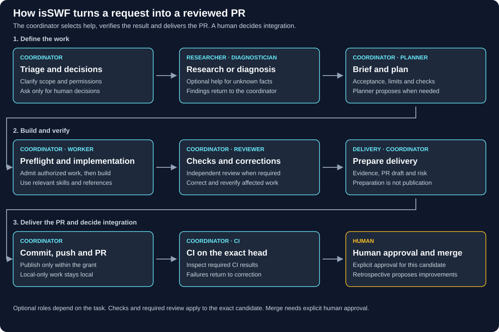

# isSWF

English | [Español](README.es.md)

isSWF helps you direct AI-assisted software work in small, reviewable assignments. You stay in control: installing the integration does not start agents, and a feature workflow does not authorize merging or deployment.

## Start with a native host

The current shared workflow supports native Windows and Linux with **Pi** or **Claude Code**. Pi delegates through the separately installed `pi-subagents` extension; Claude Code uses its native agents. These host-native tasks do not require the compiled legacy executor or a project runtime pin. Host configuration, capability limits and verification evidence are described in [host support](docs/host-portability.md).

1. Install the integration for your host and initialize the target repository; see [installation](docs/en/installation.md).
2. In the target repository, run `/skill:isswf-setup` in Pi or `/isswf:isswf-setup` in Claude Code.
3. To start a task, explicitly address the isSWF coordinator. Ordinary requests do not activate an automatic pipeline.

Setup prepares project-specific choices and the bounded coordinator entry in the root `AGENTS.md`. The entry is triggered by an explicit coordinator/isSWF request, not every coding request. Setup or installation alone does not grant future actions or prove a model is available. See [getting started](docs/en/getting-started.md).

## How work is recorded and delivered

Before native dispatch, the coordinator records a durable initiative plan and a curated job brief in the project's existing state directory (`.isswf` or historical `.factory`). Small tasks need no planner call or artifact bundle. Workers and reviewers return candidate-specific evidence; checks and review are selected proportionately rather than being mandatory roles for every task. Optional context tools such as Engram or Codegraph do not replace the project records.

A selected feature-to-PR request follows the project's prepared delivery policy, with bounded checks and review as applicable. Delivery of a PR is separate from the human decision to integrate it into the base branch. A request may set narrower local-only boundaries; GitHub tracking alone is not publication permission. See [durable work](docs/durable-work.md), [how the factory works](docs/en/reference.md), and [development checks](docs/en/development.md).

## Workflow diagrams

The [overview](docs/en/workflow.svg) is a quick summary. The diagrams retain legacy execution details and are navigation aids, not the authority for current native-host behavior; use the linked guides for the current contract. The [complete English workflow](docs/en/workflow.html) and [complete Spanish workflow](docs/es/workflow.html) open locally in a browser; GitHub's source view does not render these HTML files as a site.

GitHub Pages is configured to use GitHub Actions. After this workflow is available on `main`, open **Actions → Publish workflow diagrams → Run workflow**, select `main`, and run it when publication is authorized. There is no automatic deployment on push. Once the first deployment succeeds, the diagrams will be available at [https://iseoane.github.io/isSWF/](https://iseoane.github.io/isSWF/); configuration alone does not make that address live. The staging step allowlists only the bilingual landing page and the two complete workflow diagrams. Until deployment succeeds, use the repository files or download them for local viewing.

## Retained compiled release (legacy path)

The older compiled-executor installation is a separate path, not a prerequisite for new native-host tasks. Its documented release evidence targets Linux x64; it has different runtime, isolation and migration constraints and does not certify native Windows/macOS execution. Existing installations are not migrated by adopting the native workflow. Consult [installation and legacy-runtime limits](docs/en/installation.md) and the exact release evidence before selecting that path. The package manifest version is not evidence of a published release; do not infer a latest release or package-registry publication from it.

## More

- [Documentation index](docs/en/index.md)
- [Installation and updates](docs/en/installation.md)
- [First request](docs/en/getting-started.md)
- [Host support](docs/host-portability.md)
- [Glossary](GLOSSARY.md)
- [Contributing](docs/en/development.md)

## License

MIT.
