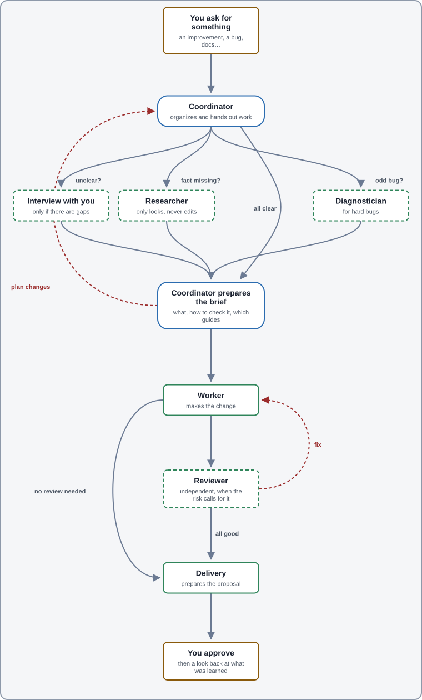

# isSWF

English | [Español](README.es.md)

isSWF is an AI-assisted software factory: AI agents do the work and you make the decisions. It splits a request into small jobs that are easy to check, picks the checks that match the risk, and keeps evidence for what was done, so nothing is merged or published unless you say so.

<table>
<tr>
<td width="50%" valign="top"></td>
<td width="50%" valign="top"></td>
</tr>
</table>

The animation on the left is a simulated, shortened session in Claude Code, not a recording. It follows the steps in the next section.

The picture on the right is a summary: boxes are steps and arrows show where the work goes next. For the version where each step lists the questions it asks itself, open the [interactive flowchart](https://iseoane.github.io/isSWF/docs/en/workflow.html) ([Español](https://iseoane.github.io/isSWF/docs/es/workflow.html)). [How work is decided](docs/en/reference.md#how-work-is-decided-and-who-decides-it) explains it in words.

## A first complete session

1. **Install it.** isSWF works with **Pi** and with **Claude Code**, the coding assistants the agents run in, on Windows and Linux. Follow the [installation guide](docs/en/installation.md) for your host. Pi also needs the separately installed `pi-subagents` extension, and [host support](docs/host-portability.md) lists what each one can do. Installing does not start any agent.
2. **Set up your project.** In the repository where you want to work, run `/skill:isswf-setup` in Pi or `/isswf:isswf-setup` in Claude Code. Setup asks which models to use, where to keep the work and what the checks are, and it prepares a small entry in the project's `AGENTS.md`.
3. **Make a first request.** Address the coordinator, the agent that plans the work and calls the others, for example: `/isswf:isswf-coordinator Add a clear-filter button that restores the full list.` Use `/skill:isswf-coordinator` in Pi. An ordinary request does not start the factory; only an explicit one does. See [your first request](docs/en/getting-started.md).
4. **Not sure what to ask?** Run `/skill:isswf-howto` in Pi or `/isswf:isswf-howto` in Claude Code. It tells you which skill (a ready-made task you can ask for by name) or flow fits, links its source, and ends with a prompt you can send to the coordinator. It never starts work. For instance (illustrative):

   > You: `/isswf:isswf-howto` A test in my project fails now and then and I do not know why. What should I use?
   >
   > Answer: An unknown, intermittent cause is a debugging task, which the [isswf-debug](.agents/skills/isswf-debug/SKILL.md) skill covers. It reproduces the failure and gathers evidence of the cause; it changes no code unless you ask. You can send the prompt below to the coordinator, or run `/isswf:isswf-debug` directly.
   >
   > ```text
   > Investigate why the test checkout.spec fails intermittently. Diagnose only: find the cause with evidence and do not change any code. Report the cause and the next step.
   > ```

5. **The coordinator plans and records.** It writes a plan and a short brief (the instructions for one job) as Markdown files in your project, and a worker, an agent that changes code and checks it, does each job. The records of one initiative, a tracked piece of work, are described in [how an initiative is recorded](docs/en/reference.md#how-an-initiative-is-recorded).
6. **Follow the progress.** In Claude Code, turn on the [initiatives panel](docs/en/reference.md#the-initiatives-panel) to see plans, jobs and reviews as cards. A similar panel for Pi is coming soon (see [possible future actions](docs/en/future-actions.md)).

   

   The panel animation is simulated, with demo data. It shows only fields and states that the panel renders.

   The panel also has an AutoWakeUp switch, off by default: when it is on and the five-hour usage window reaches 90% or more while a job is in progress, the open pane schedules one prompt for the window reset plus five minutes, asking the coordinator to reconcile state and continue only work already authorised. The schedule lasts only while the Claude session stays open. See the [initiatives pane](docs/en/installation.md#initiatives-pane).
7. **Review, PR and your approval.** When the risk calls for it, a reviewer, a separate agent, checks the change. In a project that uses GitHub, the coordinator then opens a pull request (PR) and waits for continuous integration (CI), the automatic checks, to pass; a project with no remote keeps the work local. You decide whether to merge. Nothing is merged or published without you. See [how changes reach main](docs/en/reference.md#how-changes-reach-main).
8. **Close with a retrospective.** When the work is finished, the coordinator runs the `isswf-retrospective` skill, which looks back at what happened and proposes improvements as drafts. You decide which to keep.

## How it works, in four lines

- **Small, verifiable jobs.** Each job is sized by how hard it is to check, and a large one is split. [Splitting work into jobs](docs/en/reference.md#splitting-work-into-jobs-by-size).
- **Tests chosen by risk.** Each job runs the tests that match its change; the full check runs at the end and, with GitHub, in CI for every PR. [Which tests run and when](docs/en/reference.md#which-tests-run-and-when).
- **Three ways to verify.** Mechanical (also called deterministic) checks by tools, empirical checks by running tests, and semantic review by a reviewer who reads the change. [Three ways to verify](docs/en/reference.md#three-ways-to-verify).
- **Nothing is published without you.** With GitHub delivery, the factory opens a PR and you approve the merge; without a remote, nothing leaves your machine until you publish it. [Who decides what](docs/en/reference.md#how-work-is-decided-and-who-decides-it).

Automatic checks do not depend on an agent remembering: they refuse a commit on the wrong branch or a shell command that fetches packages, and they remind the coordinator to reload its instructions and re-read the records after a long chat is compacted (observed on a manual compaction in Claude Code). Before a branch is merged, pushed or opened as a PR, a verification stamp shows that the project's checks passed on that commit; by default a missing stamp only adds a note, and `enforce` mode refuses. `isswf-status --next` prints the job to start next without calling a model, and token reports come from recorded counters, while costs are estimates, not billing. [More safeguards and reports](docs/en/reference.md#more-safeguards-and-reports) lists each one.

## What it builds on

Two optional tools make the agents better informed. isSWF works without them and does not install them.

- [Engram](https://github.com/Gentleman-Programming/engram) gives agents persistent memory across sessions, so decisions and discoveries are not lost. It runs on your machine and has its own installer.
- [Codegraph](https://github.com/colbymchenry/codegraph) indexes your code as a graph on your machine, so agents find where things are and what depends on them with fewer file reads.

Thanks to the Gentleman-Programming organization, which builds Engram, and to colbymchenry, who builds Codegraph, and to their contributors. Setup reports whether each one is available, and the [installation guide](docs/en/installation.md#initialise-a-project) explains how to connect them.

## More

- [How the factory works](docs/en/reference.md)
- [Documentation index](docs/en/index.md)
- [Glossary](GLOSSARY.md)
- [Contributing](docs/en/development.md)
- License: MIT.
