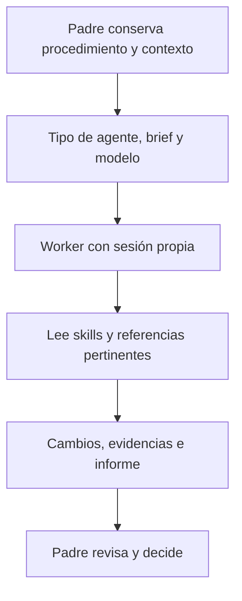

# Cómo Pstack compone agentes y skills

## Estado de la investigación

Investigación completada para la composición de agentes y skills. Dos exploradores leyeron las políticas del original y del port. Un tercer agente sintetizó los hallazgos y comprobó fuentes decisivas. El padre trazó el runtime Pi y ejecutó tests offline. Este documento no es una evaluación empírica de la calidad del código generado ni una decisión de arquitectura de isSWF.

El checkpoint de ejecución no aplica: es una investigación, no una implementación de producto. Los tests descritos abajo verifican mecanismos del port, no calidad de código generado.

## Revisiones fijadas

- Original Cursor, repositorio `cursor/plugins`, commit `1dcc2bacde73ddd284803b7af28164d0436198fc`. Subárbol `pstack`: `8824c764d99583f7cc8059c915296e444c53f060`.
- Port `michael-denyer/pstack-claude`, commit `990cd7b02ac6f3e8f825716f7c72e2f06d8f4a92`, versión de paquete `0.9.84`.
- Snapshots locales bajo `/tmp/isswf-pstack-research.C7F6kB/`. Son copias de investigación, no dependencias de isSWF.

El intento inicial con el proveedor configurado falló por su límite de uso. Las dos exploraciones profundas y la síntesis usaron el modelo de la sesión como fallback. Son perspectivas de lectura separadas, no una revisión multi-modelo independiente.

## Pstack no convierte cada skill en un agente

Pstack combina tipos de agente, playbooks, skills y briefs. El padre elige un procedimiento y conserva su responsabilidad. El tipo de agente establece el comportamiento inicial del worker. El brief lo acota para un encargo concreto. Las skills añaden procedimientos, criterios y rúbricas cuando corresponden. Tener una skill disponible no equivale a haber leído su cuerpo.

Hay dos rutas de enriquecimiento, no una herencia uniforme:

1. **Delegado de estilo completo.** El padre lanza `poteto-agent`, proporciona la ruta absoluta de poteto-mode y delimita el encargo. El worker recibe la instrucción de leer poteto-mode completo y las hojas de principios pertinentes.
2. **Worker de un workflow específico.** Skills como `how`, `swarm` e `interrogate` prescriben agentes genéricos con prompts y referencias propios. No pasan automáticamente por `poteto-agent`.

La obligación de lectura está en el cuerpo de [poteto-agent original](https://github.com/cursor/plugins/blob/1dcc2bacde73ddd284803b7af28164d0436198fc/pstack/agents/poteto-agent.md) y del [port](https://github.com/michael-denyer/pstack-claude/blob/990cd7b02ac6f3e8f825716f7c72e2f06d8f4a92/plugins/pstack/agents/poteto-agent.md). No contienen toda la metodología: mandan abrirla. El padre sigue siendo dueño del playbook, de la coordinación y de la revisión del diff.

[How](https://github.com/michael-denyer/pstack-claude/blob/990cd7b02ac6f3e8f825716f7c72e2f06d8f4a92/plugins/pstack/skills/how/SKILL.md) distingue exploradores y explainer. [Swarm](https://github.com/michael-denyer/pstack-claude/blob/990cd7b02ac6f3e8f825716f7c72e2f06d8f4a92/plugins/pstack/skills/swarm/SKILL.md) exige briefs autosuficientes y resultados respaldados por evidencia. El wrapper [thermo](https://github.com/michael-denyer/pstack-claude/blob/990cd7b02ac6f3e8f825716f7c72e2f06d8f4a92/plugins/pstack/agents/thermo-nuclear-review-subagent.md) ordena cargar su rúbrica. Son contratos diferentes.



## Recorrido de una feature y de un bug

El playbook de feature del [original](https://github.com/cursor/plugins/blob/1dcc2bacde73ddd284803b7af28164d0436198fc/pstack/skills/poteto-mode/playbooks/feature.md) y del [port](https://github.com/michael-denyer/pstack-claude/blob/990cd7b02ac6f3e8f825716f7c72e2f06d8f4a92/plugins/pstack/skills/poteto-mode/playbooks/feature.md) prescribe este recorrido:

1. Entender el subsistema mediante `how`.
2. Explorar el diseño mediante `architect` y sus candidatos de `arena`.
3. Identificar bloqueos, trabajo independiente, estado compartido y descomposición segura.
4. Delegar implementación con alcance, estructura de datos y criterios de éxito. Si todavía hay varias formas válidas de implementar, usar arena.
5. Verificar sobre la superficie correspondiente.
6. Ordenar unidades y commits, revisar el diseño disputado y abrir PR.

El [runner de architect](https://github.com/michael-denyer/pstack-claude/blob/990cd7b02ac6f3e8f825716f7c72e2f06d8f4a92/plugins/pstack/skills/architect/references/runner-prompt.md) recibe tarea y grounding, abre la skill y deriva firmas, tipos, módulos y rationale a partir del uso del consumidor. [Arena](https://github.com/michael-denyer/pstack-claude/blob/990cd7b02ac6f3e8f825716f7c72e2f06d8f4a92/plugins/pstack/skills/arena/SKILL.md) separa candidatos, cross-judge y decisión del padre. La solución elegida no es una mezcla automática de shapes incompatibles.

El port añade reconciliación de desviaciones aceptadas con el sketch antes de cerrar unidades o entregar el contrato al siguiente worker. La diferencia está declarada en [forks.json](https://github.com/michael-denyer/pstack-claude/blob/990cd7b02ac6f3e8f825716f7c72e2f06d8f4a92/tools/forks.json) y aparece en [architect](https://github.com/michael-denyer/pstack-claude/blob/990cd7b02ac6f3e8f825716f7c72e2f06d8f4a92/plugins/pstack/skills/architect/SKILL.md). Es una adaptación del port, no una regla idéntica en ambos snapshots.

Para un bug, el [playbook específico](https://github.com/michael-denyer/pstack-claude/blob/990cd7b02ac6f3e8f825716f7c72e2f06d8f4a92/plugins/pstack/skills/poteto-mode/playbooks/bug-fix.md) comienza con reproducción real, elimina hipótesis con evidencia, acota el fix y repite el mismo repro. TDD se reserva para un camino local barato y claro. Elegir otro procedimiento no elimina la obligación de comprobar el comportamiento.

## El runtime del port muestra cómo se prepara un worker

La [declaración del paquete](https://github.com/michael-denyer/pstack-claude/blob/990cd7b02ac6f3e8f825716f7c72e2f06d8f4a92/package.json) registra el directorio de skills y la extensión Pi. [Index.ts](https://github.com/michael-denyer/pstack-claude/blob/990cd7b02ac6f3e8f825716f7c72e2f06d8f4a92/plugins/pstack/pi/index.ts#L12-L20) conecta el runner, las herramientas de agentes, los prompts y las skills asociadas a rutas.

El flujo de lanzamiento se puede seguir en [AgentRunner.start y launch](https://github.com/michael-denyer/pstack-claude/blob/990cd7b02ac6f3e8f825716f7c72e2f06d8f4a92/plugins/pstack/pi/agents.ts#L191-L259):

1. El padre llama `agent` con tipo, prompt del encargo, modelo y opciones de aislamiento.
2. `loadAgentTypes` obtiene el cuerpo del archivo del agente. `general-purpose` tiene un cuerpo vacío. Los tipos Pstack proceden de `agents/` y `effort-agents/`.
3. Se resuelve el modelo. Una opción explícita prevalece sobre el modelo del archivo; si no hay opción, puede heredar el modelo de la sesión.
4. Se crea una identidad con sesión propia, directorio de persistencia, cwd y, si se pidió, worktree.
5. El cuerpo del agente se escribe como archivo de prompt con permisos `0600`.
6. Se lanza un proceso Pi con la extensión Pstack, el directorio de skills y ese cuerpo añadido al system prompt.
7. El encargo se transmite como un comando RPC `prompt` por stdin. No se transmite la conversación del padre en esta llamada.

La evidencia decisiva de carga está en [agents.ts](https://github.com/michael-denyer/pstack-claude/blob/990cd7b02ac6f3e8f825716f7c72e2f06d8f4a92/plugins/pstack/pi/agents.ts#L121-L129) y [launch](https://github.com/michael-denyer/pstack-claude/blob/990cd7b02ac6f3e8f825716f7c72e2f06d8f4a92/plugins/pstack/pi/agents.ts#L235-L243). `--skill` hace disponible el catálogo; `--append-system-prompt` añade el comportamiento del agente. Eso no equivale a haber leído el contenido íntegro de todas las skills.

[LoadAgentTypes](https://github.com/michael-denyer/pstack-claude/blob/990cd7b02ac6f3e8f825716f7c72e2f06d8f4a92/plugins/pstack/pi/config.ts#L139-L169) extrae cuerpo, modelo y esfuerzo. En esta función, un campo descriptivo como `tools` no se convierte en una restricción de herramientas. La opción `readonly` de la llamada sí elimina `edit` y `write`. `bash` permanece disponible: no es un sandbox de solo lectura.

## Padre e hijo no reciben exactamente las mismas reglas

[RegisterPromptSections](https://github.com/michael-denyer/pstack-claude/blob/990cd7b02ac6f3e8f825716f7c72e2f06d8f4a92/plugins/pstack/pi/prompt.ts#L25-L39) añade la guía de herramientas Pi y las reglas de llamadas paralelas en cada inicio de turno. Añade también la hoja completa de modelos si existe.

El mandato de entrada en poteto-mode solo se inyecta en profundidad cero y cuando el hook no está desactivado. Un hijo recibe la hoja de configuración, pero no ese mandato. Por tanto, el cuerpo de `poteto-agent` y el prompt del encargo importan: un `general-purpose` no adquiere automáticamente el mismo comportamiento por estar dentro del mismo árbol de procesos.

El catálogo queda disponible mediante `--skill` en cada lanzamiento del hijo. La carga del contenido de una skill y la aplicación de sus pasos siguen requiriendo acciones del modelo. La extensión no convierte la prosa de poteto-mode en una máquina que ejecuta por sí sola cada workflow.

## Las skills por ruta llevan un recordatorio, no una ejecución automática

[Path-skills.ts](https://github.com/michael-denyer/pstack-claude/blob/990cd7b02ac6f3e8f825716f7c72e2f06d8f4a92/plugins/pstack/pi/path-skills.ts#L42-L60) escucha resultados exitosos de `read`, `edit` y `write`. Si una ruta coincide con una skill aún no anunciada, añade una nota con su ruta absoluta y pide leerla.

Esto es carga progresiva por contexto. No añade el cuerpo de la skill al resultado, no prueba que el agente lo lea y no bloquea una edición anterior a esa lectura. El recordatorio aparece después del resultado de la herramienta. La prueba offline de rutas confirma la nota, su ubicación y que no se repite; no confirma obediencia de un modelo real.

## Background, retorno y límites de recuperación

[Agent-tools.ts](https://github.com/michael-denyer/pstack-claude/blob/990cd7b02ac6f3e8f825716f7c72e2f06d8f4a92/plugins/pstack/pi/agent-tools.ts#L65-L95) permite devolver un identificador inmediatamente cuando `run_in_background` es verdadero. El padre puede seguir actuando sin esperar el resultado en esa llamada.

Cuando termina el proceso, [finish](https://github.com/michael-denyer/pstack-claude/blob/990cd7b02ac6f3e8f825716f7c72e2f06d8f4a92/plugins/pstack/pi/agents.ts#L260-L279) persiste el estado y envía una notificación. Un resultado background normal puede iniciar un nuevo turno del padre. Esto es un mecanismo real para recuperar atención, no solo una instrucción de comprobar archivos periódicamente.

[OutcomeOf](https://github.com/michael-denyer/pstack-claude/blob/990cd7b02ac6f3e8f825716f7c72e2f06d8f4a92/plugins/pstack/pi/agents.ts#L88-L100) clasifica como `completed` un run que se asentó con texto final y sin error. No inspecciona tests del producto, commits ni veredictos de revisión. `completed` significa que el run acabó, no que la entrega esté aceptada o lista para merge.

Los estados de proceso y los transcripts se conservan. [Restore](https://github.com/michael-denyer/pstack-claude/blob/990cd7b02ac6f3e8f825716f7c72e2f06d8f4a92/plugins/pstack/pi/agents.ts#L380-L423) examina procesos y evita retomar una sesión que aún tiene un proceso vivo sin confirmar su identidad. Eso no es un scheduler durable que reconstruye un grafo de trabajos.

[Index.ts](https://github.com/michael-denyer/pstack-claude/blob/990cd7b02ac6f3e8f825716f7c72e2f06d8f4a92/plugins/pstack/pi/index.ts#L21-L38) detiene hijos al cerrar la sesión y los señala si termina el padre. Background no significa que todos los trabajos continúen después de cerrar el coordinador. Este límite importa para isSWF y debe verificarse antes de elegir su runtime.

El límite de profundidad se expresa quitando la herramienta `agent` al tercer nivel. Los worktrees aíslan archivos y ramas por escritor cuando se solicitan. No impiden escribir fuera de ellos mediante otras herramientas.

## Comprobación ejecutada

Se ejecutó el código de la extensión contra el harness y el proceso Pi simulado del propio port:

```bash
bun test tests/pi/agents-launch.test.mjs \
  tests/pi/agents-run.test.mjs \
  tests/pi/agents-messages.test.mjs \
  tests/pi/prompt.test.mjs \
  tests/pi/path-skills.test.mjs
```

Resultado leído del log: **75 tests pasaron, 0 fallaron, 224 assertions**. El log se conserva en [pstack-runtime-tests.log](pstack-runtime-tests.log), con [alcance y reproducción](evidencia-pstack-runtime.md). El entorno usó Bun `1.4.2` y el `typebox` del Pi instalado mediante un symlink temporal de `node_modules` en el snapshot, eliminado tras la prueba. No se instalaron paquetes ni se cambiaron configuraciones del usuario.

Las pruebas verifican el prompt y los argumentos que llegan al proceso hijo, el retorno background, los mensajes, la selección de modelo, la inyección distinta en padre e hijo y el recordatorio de skills por ruta. No son una prueba live de un modelo cumpliendo las skills ni una prueba de la futura factory.

## Entrega visual y riesgo en las fuentes

La [skill PR de Matt](https://github.com/mattpocock/skills/blob/main/skills/engineering/pr/SKILL.md), consultada en `main` mutable, propone un resumen visual, pruebas antes y después, y `Merge Danger`. Este último distingue reversibilidad y alcance del impacto. El visual se elige según el cambio: captura, Mermaid, pseudocódigo o esquema de responsabilidades. No exige un diagrama ornamental para cada PR.

El playbook de apertura de PR del [original](https://github.com/cursor/plugins/blob/1dcc2bacde73ddd284803b7af28164d0436198fc/pstack/skills/poteto-mode/playbooks/opening-a-pr.md) y del [port](https://github.com/michael-denyer/pstack-claude/blob/990cd7b02ac6f3e8f825716f7c72e2f06d8f4a92/plugins/pstack/skills/poteto-mode/playbooks/opening-a-pr.md) pide explicar motivo, cambio, alcance, alternativas pertinentes, blast radius y verificaciones. Lo concibe como un briefing corto, no un diario. Los detalles extensos van en un artefacto enlazado. También exige PRs ready, no draft. Por tanto, nuestra propuesta anterior de drafts tempranos es una adaptación propia, no una práctica que podamos atribuir a Pstack.

**Propuesta pendiente para isSWF.** Combinar visual y pruebas de Matt con el alcance y las alternativas de Pstack. Añadir problemas relevantes y resolución cuando expliquen una decisión o un riesgo residual. El riesgo debe describir afectados, fallo posible, mitigación, incertidumbre y reversibilidad; un color o la palabra bajo no bastan.

## Retrospectiva y mejora de las reglas

[Retro de Matt](https://github.com/mattpocock/skills/blob/main/skills/engineering/retro/SKILL.md), consultada en `main` mutable, lee la sesión y propone mejoras de navegación, comprobaciones, estándares, economía de herramientas y acceso a información. Prefiere checks deterministas para errores mecánicos y reserva documentación para decisiones de criterio. Presenta candidatos por severidad. No define un trigger automático al cierre de la sesión.

[Reflect del port](https://github.com/michael-denyer/pstack-claude/blob/990cd7b02ac6f3e8f825716f7c72e2f06d8f4a92/plugins/pstack/skills/reflect/SKILL.md) lee el transcript activo, usa tres perspectivas y un sintetizador, y separa Accepted, Rejected y Backlog. Pide aprobación explícita para editar skills porque afectan trabajos futuros. Envía a backlog lo que merece enforcement estructural. Indica crear esos items de backlog sin esperar. Ese alcance externo necesitaría autorización propia en isSWF.

[Correct del port](https://github.com/michael-denyer/pstack-claude/blob/990cd7b02ac6f3e8f825716f7c72e2f06d8f4a92/plugins/pstack/skills/correct/SKILL.md) agrupa errores repetidos y trata de eliminarlos con arquitectura, tipos, lint y pruebas antes de escribir más instrucciones. Pide demostrar que la nueva comprobación falla en un error real anterior.

**Propuesta pendiente para isSWF.** Al cierre acordado de una sesión, producir candidatos respaldados por hechos. Separar mejoras del proyecto de problemas de la factory. Estos últimos podrían convertirse en issues deduplicadas y pasar por triage. No confundir detectar una mejora con autorizar cambiar automáticamente políticas compartidas.

## Qué conservar y qué adaptar en isSWF

La propuesta es conservar coordinación responsable, briefs autosuficientes, catálogo de skills, aislamiento de escritores, evidencias y revisión contextualizada. El coordinador elige el procedimiento general y el worker aplica las skills técnicas pertinentes dentro del encargo.

Hay diferencias que no se pueden ocultar al adoptar Pstack:

- **Slices verticales.** Feature permite workstreams por archivos, servicios o capas. isSWF debe definir sus unidades por comportamiento observable, no atribuir esa garantía a Pstack.
- **Commit no significa slice terminada.** Architect permite guardar un scaffold con rotura temporal acotada. Los commits frecuentes ayudan a recuperar el trabajo, pero no sustituyen la aceptación funcional ni imponen un límite automático a cambios sin commit.
- **PR temprana no significa draft.** Opening-a-PR exige ready. Nuestra propuesta de publicar drafts durante la implementación se debe definir como política propia.
- **Validación de producto.** El [prompt de interrogate](https://github.com/michael-denyer/pstack-claude/blob/990cd7b02ac6f3e8f825716f7c72e2f06d8f4a92/plugins/pstack/skills/interrogate/references/reviewer-prompt.md) indica no cuestionar la intención. Comprueba la ejecución contra el objetivo recibido, no que construirlo sea una buena decisión de producto.
- **Roles no equivalen a permisos.** `Comment-sicko` y `no-comments` no son una revisión necesariamente pasiva. Que un agente se llame reviewer no impide que cambie archivos.
- **Background no equivale a servicio durable.** La disponibilidad conversacional y la continuación tras reinicios son requisitos distintos. Este runtime solo demuestra una parte del primero y no resuelve por sí solo el segundo.
- **Port y original no son intercambiables.** Además de la reconciliación del diseño, el port adapta la ejecución de programas a background local y deja los merges de autopilot-full al operador. Los [playbooks del port](https://github.com/michael-denyer/pstack-claude/tree/990cd7b02ac6f3e8f825716f7c72e2f06d8f4a92/plugins/pstack/skills/poteto-mode/playbooks) y el registro de forks documentan esas diferencias.

No se han ejecutado una feature o un bug completos bajo un modelo siguiendo estas instrucciones. Tampoco se ha probado la integración de Engram, seleccionado runtime para isSWF o autorizado ninguna operación Git remota.

La conclusión no es instalar todo Pstack. Es diseñar contratos explícitos para el coordinador, el worker y las revisiones, y seleccionar las prácticas útiles sin confundir sus instrucciones con comprobaciones que todavía hay que construir.
